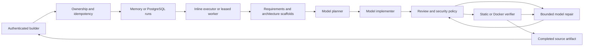

# Builder orchestration research — 2026-09-05

## Product and repository findings

ICOGON already contained a typed seven-role pipeline, PostgreSQL lease-fenced worker, event API and Docker verifier. The running service always selected the mock provider, the frontend omitted the required idempotency key, and the active builder simulated a reply without submitting work. Extending those boundaries was lower risk than introducing another agent framework.

## Primary-source research and implementation decisions

1. [Lovable Build mode](https://docs.lovable.dev/features/agent-mode) describes implementation, inspection, debugging and verification as a user-visible flow. ICOGON now exposes the actual pipeline, plan, files and outcome instead of a timed simulated chat response. This is a product analogy, not knowledge of Lovable's private implementation.
2. [Anthropic: Building effective agents](https://www.anthropic.com/engineering/building-effective-agents) distinguishes predefined workflows from autonomous agents and recommends complexity only where it improves outcomes. ICOGON retains the existing deterministic coordinator, specialized contracts and bounded evaluator/repair cycle rather than adding freely communicating agents.
3. [Groq structured outputs](https://console.groq.com/docs/structured-outputs) distinguishes strict schemas, best-effort schemas and JSON-object mode. For compatibility across configurable models this gateway requests JSON objects and performs Pydantic validation locally. That is **not** a strict provider-side schema guarantee. Malformed, missing-usage, refused and truncated responses fail closed.

## Shipped architecture

Provider prompts request complete project snapshots. Follow-up requests reference an owned completed run; the server supplies its files and checks the same project. New builds select HTML, React or React + Three.js using a structured model-designed blueprint. Generated applications requiring external services must explain missing configuration.

Keys stay server-side. Provider response bodies are not exposed in failure messages. Context is capped at 500 KB before a paid request; the existing 100-file and individual-file policies constrain results. No tools are given arbitrary shell access. Cancellation is cooperative at step boundaries, including after a call returns. Cancel flags survive worker saves in both repositories.

## What this release does not claim

- Requirements and architecture are deterministic templates, not independent reasoning models; review checks structure and policy, not complete requirement satisfaction.
- Memory execution and browser-local run IDs are development conveniences, not durable history.
- Static verification does not compile or test generated software.
- The iframe supports self-contained HTML and compiled React/Three.js artifacts, not arbitrary Node servers, npm packages or Vite plugins. It blocks external resources, API calls and persistent storage.
- There is no plan approval mode, arbitrary repository import, git commit/push, hosted app publishing, billing or tenant rate limiting yet.
- No real model call, live Supabase login, live PostgreSQL concurrency or Docker runtime was validated without their configured dependencies. Mock transport tests validate integration contracts, not model quality.

## Next product increments

1. Provision project schema/RLS and durable workers; test worker death, lease contention and restore against a real staging database.
2. Add per-user active-run limits and credit reservation/refund accounting before paid public access. Count input/output usage and enforce provider account caps; post-call token accounting cannot prevent all spend after crashes.
3. Move the shipped virtual-file React/Three.js compiler into resource-isolated build workers with separate preview origin and artifact storage. Never run generated package lifecycle scripts on the application host.
4. Add explicit plan approval and immutable project version selection, diffs and rollback. Current edits use the most recent completed run in this browser, with full snapshots in run state.
5. Evaluate a fixed set of prompts against chosen real models: build pass rate, task success, repair rate, latency and cost. Add semantic reviewers only when measured improvement justifies another model call.
6. Add deployment adapters and domain configuration after preview/build acceptance. Keep publishing a separate user action with a reviewed artifact.

## Verification evidence

Backend tests cover pipeline/repair, budgets, schema validation, timeout classification, redaction, project/run ownership, idempotency, follow-up context, cancellation, lease contracts and sandbox controls. Additional real-compiler tests cover React/Three.js bundling, invalid imports, syntax errors and generated config isolation. Frontend build and scoped lint verify changed source. Browser tests use test authentication; they do not validate live Supabase or model quality.

## Design and 3D extension

- [Anthropic context engineering](https://www.anthropic.com/engineering/effective-context-engineering-for-ai-agents) supports supplying relevant structured context. The planner gets bounded excerpts plus a manifest; implementation gets source, and repair/review receive the current snapshot without duplicate old source. Versioned project playbooks provide focused design, interaction and performance guidance.
- [esbuild plugins](https://esbuild.github.io/plugins/) provide a virtual-file namespace and custom module resolution. ICOGON compiles snapshots with a fixed trusted plugin and installed package allowlist; generated config and scripts never execute. This is a compiler boundary, not an OS isolation guarantee.
- [Three.js responsive rendering](https://threejs.org/manual/en/responsive.html) informs canvas sizing and pixel-ratio limits. [Three.js cleanup](https://threejs.org/manual/en/cleanup.html) informs geometry/material/renderer disposal. The curated scene also pauses rotation for reduced motion and supplies a WebGL-unavailable fallback.
- [WebContainers browser support](https://webcontainers.io/guides/browser-support) describes cross-origin isolation requirements. A fixed compiler was chosen here to avoid adding an in-browser Node runtime and those deployment requirements for the initial React/3D flow.

Intelligent planning now requires audience, template, art direction, design tokens, pages, interactions, acceptance criteria and honest limitations. Task IDs/dependencies are validated. Polished mode adds source-level critique before compilation; failed findings and actual compiler errors feed bounded repairs. This does not claim autonomous visual design evaluation or universal project support. Model-driven quality and speed still need live evaluations.

## Incremental context and communication

Follow-up generation uses a content-addressed file manifest and typed file plan. The
coder receives relevant source instead of the complete project and returns only
declared deltas. The coordinator reconstructs a full snapshot and rejects unplanned
changes, including lockfile mutation. This reduces repeated tokens while keeping
verification and export deterministic.

Agent collaboration follows a manager/blackboard pattern: immutable checkpoint
artifacts plus small typed handoff messages. [OpenAI's practical guide](https://cdn.openai.com/business-guides-and-resources/a-practical-guide-to-building-agents.pdf) recommends growing orchestration complexity incrementally. [Anthropic's multi-agent engineering report](https://www.anthropic.com/engineering/multi-agent-research-system) describes the coordination cost and benefits of subagents for genuinely independent work. [AutoGen's team documentation](https://microsoft.github.io/autogen/stable/user-guide/agentchat-user-guide/tutorial/teams.html) emphasizes termination conditions and extra team scaffolding. Website implementation is dependency-ordered, so ICOGON keeps deterministic routing and reserves future parallel agents for independent research/assets instead of broadcasting every message to every role.
